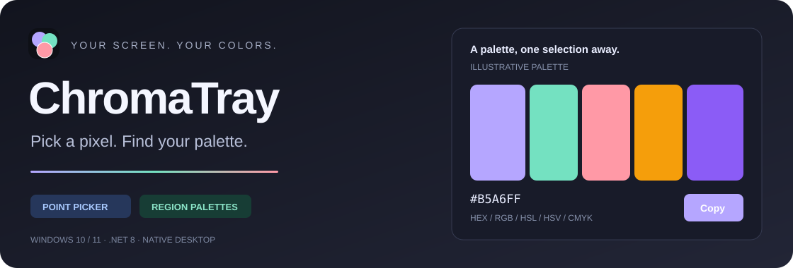

<a id="readme-top"></a>

<p align="center">
  
</p>
<h1 align="center">ChromaTray</h1>
<p align="center"><strong>Pick a pixel. Find your palette.</strong></p>
<p align="center">Exact screen colors and useful region palettes, one shortcut away.</p>

<p align="center">
  <a href="https://github.com/Gh0st3r0k/ChromaTray/actions/workflows/release.yml"></a>
  <a href="https://github.com/Gh0st3r0k/ChromaTray/actions/workflows/docs.yml"></a>
  
  
  <a href="LICENSE"></a>
</p>

<p align="center">
  <a href="#features">Features</a> ·
  <a href="#quick-start">Quick start</a> ·
  <a href="#controls">Controls</a> ·
  <a href="#documentation">Documentation</a> ·
  <a href="#build-and-test">Build &amp; test</a> ·
  <a href="#run-it-on-your-own-pc">Local setup</a>
</p>



<p align="center"><sub>Feature illustration; not a screenshot of the running application.</sub></p>

ChromaTray is a Windows tray app for bringing screen colors into your code and design work. Pick one pixel to copy its value, or select a rectangle to discover its most frequent colors and their shares. Everything runs locally, without an account, API key, or backend service.

<details>
<summary>Contents</summary>

- [Features](#features)
- [Quick start](#quick-start)
- [Controls](#controls)
- [Color accuracy](#color-accuracy)
- [Export examples](#export-examples)
- [Documentation](#documentation)
- [Development roadmap](#development-roadmap)
- [Build and test](#build-and-test)
- [AI-assisted development](#ai-assisted-development)
- [License](#license)
- [Run it on your own PC](#run-it-on-your-own-pc)

</details>

## Features

| | What you get |
| --- | --- |
| **Precise point picking** | An 11 × 11 magnifier, screen coordinates, one clear cursor, and arrow-key adjustments in physical pixels. |
| **Region palettes** | Frequency-sorted colors, pixel counts, and percentages from a rectangular selection. |
| **Original RGB values** | Uncompressed screen capture with exact colors by default. Optional shade grouping uses a real sampled color for each group. |
| **Five color formats** | HEX, RGB, HSL, HSV, and CMYK, with individual copy buttons and configurable active formats. |
| **Ready-to-use exports** | Copy active representations, a primary-format list, CSS custom properties, or JSON. |
| **Tray workflow** | Configurable global shortcuts, a tray menu, and capture while the dashboard is hidden. |
| **Multiple displays** | Physical screen coordinates, negative monitor positions, and Per-Monitor V2 DPI awareness. |
| **A consistent theme** | Navy, blue, aqua, and mint: `#161D6F` · `#0B2F9F` · `#98DED9` · `#C7FFD8`. |

## Quick start

### Run from source

Use **Windows 10/11 x64** with the **.NET 8 SDK, version 8.0.4xx**. The SDK feature band is pinned in [global.json](global.json).

```powershell
git clone https://github.com/Gh0st3r0k/ChromaTray.git
cd ChromaTray
dotnet restore ChromaTray.csproj --locked-mode
dotnet run --project ChromaTray.csproj -c Release --no-restore
```

Press **Ctrl+Shift+X**, point at a color, adjust with the arrow keys, then press **Enter**. The primary color value is copied to your clipboard. Use **Ctrl+Shift+Z** and drag a rectangle to extract a palette.

### Use a published executable

Tagged releases publish these assets on the [Releases page](https://github.com/Gh0st3r0k/ChromaTray/releases):

| Asset | Requirement |
| --- | --- |
| `ChromaTray-win-x64-standalone.exe` | Includes .NET; no separate runtime installation. |
| `ChromaTray-win-x64-lightweight.exe` | Requires the **x64 .NET 8 Desktop Runtime**. |
| `SHA256SUMS.txt` | SHA-256 checksums for the executables. |

See the [local setup guide](docs/RUNNING.md) for Visual Studio, publishing your own EXE, settings recovery, and troubleshooting.

## Controls

| Action | Shortcut or control |
| --- | --- |
| Pick a screen pixel | **Ctrl+Shift+X** or **Pick Point** |
| Move the point by one physical pixel | **← ↑ ↓ →**; hold a key to repeat |
| Confirm the point | **Enter** or left click |
| Extract a region palette | **Ctrl+Shift+Z** or **Scan Region**, then drag |
| Cancel a capture | **Esc** or right click |
| Copy a palette row in the primary format | Double click or **Ctrl+C** |
| Copy one representation | **Copy** beside its value |
| Export the entire palette | Choose an export mode → **Copy palette** |
| Change shortcuts and enabled formats | **Settings** |
| Restore the dashboard | Left click the tray icon |
| Exit completely | Tray menu → **Exit** |

Closing the dashboard keeps ChromaTray in the tray. On narrow windows, **Palette** and **Inspector** become tabs. The desktop interface is in English.

The primary format is the first enabled format in this order: **HEX → RGB → HSL → HSV → CMYK**. Disable HEX if you want quick copy to use RGB. At least one format must stay enabled.

## Color accuracy

Capture freezes the desktop after hiding the application. Point mode displays the untinted snapshot; the magnifier enlarges individual pixels without interpolation. Arrow keys stop at display edges and cannot enter empty gaps between monitors; you can cross a shared edge between adjacent displays.

Screen pixels stay in an **uncompressed 32-bit bitmap**. Capture and analysis do not use JPEG, lossy compression, or resizing. Saved test previews use PNG.

**Group similar shades** is off by default. Find it on its own row below the palette heading, or in **Settings → Group similar shades (region only)**. When enabled, RGB channels are grouped in steps of eight and each group displays its most frequent original color. Point picking always returns the exact sampled pixel.

The palette contains up to **500 entries**. Percentages use the complete region before that limit, so visible shares may total less than 100%. ClearType and other antialiasing shades are included because they are already present in the captured screen image.

HDR, display color profiles, protected content, and the Windows secure desktop can affect capture results. CMYK is a mathematical RGB conversion without a print ICC profile. ChromaTray reads captured desktop pixels; it does not recover the underlying CSS or design-source colors.

## Export examples

CSS custom properties with HEX as the primary format:

```css
:root {
  --color-1: #98DED9;
  --color-2: #C7FFD8;
}
```

JSON with HEX enabled:

```json
[
  { "hex": "#98DED9", "sharePercent": 75.00 },
  { "hex": "#C7FFD8", "sharePercent": 25.00 }
]
```

Text and JSON preserve the selected formats. CSS export falls back to HEX when HSV or CMYK is primary. Percentages use a decimal point regardless of the Windows locale.

## Documentation

Browse the published guides in [English](https://gh0st3r0k.github.io/ChromaTray/), [Slovak](https://gh0st3r0k.github.io/ChromaTray/sk/), [Czech](https://gh0st3r0k.github.io/ChromaTray/cs/), [Russian](https://gh0st3r0k.github.io/ChromaTray/ru/), or [Ukrainian](https://gh0st3r0k.github.io/ChromaTray/uk/). The language selector keeps the current page, and each version has its own Unicode-aware search index. API descriptions are generated from English C# XML comments.

| File | Purpose |
| --- | --- |
| [Running locally](docs/RUNNING.md) | Install prerequisites, run the app, publish executables, and resolve common issues. |
| [Development guide](docs/DEVELOPMENT.md) | Understand the code, capture lifecycle, tests, documentation builds, and release workflow. |
| [Development roadmap](docs/ROADMAP.md) | Themes, cross-platform support, technology evaluation, and web-design palettes. |
| [Windows checklist](docs/WINDOWS-CHECKLIST.md) | Verify real desktop capture, mixed DPI, keyboard navigation, and appearance before a release. |
| [DocFX source](docs/site/index.md) | Read the site content directly in the repository. |

To build every documentation language, install **.NET 8 SDK** and **Python 3**, then run from the repository root:

```powershell
dotnet tool restore
dotnet restore ChromaTray.csproj --locked-mode
python scripts/build-docs.py
dotnet docfx serve artifacts/docs-site --port 8080
```

Open `http://localhost:8080`. On Linux/macOS, use `python3` if needed. Generated HTML and API metadata are excluded from Git. The [development guide](docs/DEVELOPMENT.md#documentation) explains editing and publishing the site.

## Development roadmap

Future ideas include light and dark themes, custom interface colors, Windows/Linux/macOS support, evaluating alternative technologies with a prototype, and five-color palettes for web design. See the [development roadmap](docs/ROADMAP.md) for scope and tradeoffs; these are ideas rather than scheduled commitments.

## Build and test

The application and full test suite require a Windows desktop. Shared algorithm tests also run on Linux and macOS.

```powershell
# Full Windows suite; also builds the application.
dotnet restore ChromaTray.Tests/ChromaTray.Tests.csproj --locked-mode
dotnet test ChromaTray.Tests/ChromaTray.Tests.csproj -c Release --no-restore

# Cross-platform color, histogram, navigation, and export tests.
dotnet restore ChromaTray.Core.Tests/ChromaTray.Core.Tests.csproj --locked-mode
dotnet test ChromaTray.Core.Tests/ChromaTray.Core.Tests.csproj -c Release --no-restore
```

Before rebuilding, choose **Exit** in the tray menu: closing the dashboard only hides it and leaves the executable in use. See [troubleshooting and window timing diagnostics](docs/RUNNING.md#troubleshooting) if a build is locked or restoration looks slow.

GitHub Actions runs Linux algorithm tests and Windows regression tests. Version tags matching `v*.*.*` additionally publish the two executables and checksums after both jobs pass. See [development and release instructions](docs/DEVELOPMENT.md).

## AI-assisted development

ChromaTray is developed by **Kostiantyn Zaitsev (Gh0st3r0k)** with AI used as a development tool. The author actively defines requirements, shapes the design and user experience, evaluates results, and guides implementation. AI tools assist with coding, refactoring, debugging, tests, and documentation, while the author directs the project and makes the final decisions.

## License

[MIT](LICENSE) · Kostiantyn Zaitsev

## Run it on your own PC

1. Install the **.NET 8 SDK, 8.0.4xx**, on Windows 10/11 x64.
2. Download or clone the repository and open PowerShell beside `ChromaTray.csproj`.
3. Run `dotnet restore ChromaTray.csproj --locked-mode`.
4. Run `dotnet run --project ChromaTray.csproj -c Release --no-restore`.
5. Use **Ctrl+Shift+X** for a pixel and **Ctrl+Shift+Z** for a region. Choose **Exit** from the tray menu when finished.

For detailed setup, troubleshooting, and settings recovery, follow [Running ChromaTray locally](docs/RUNNING.md).

[Back to top](#readme-top)
